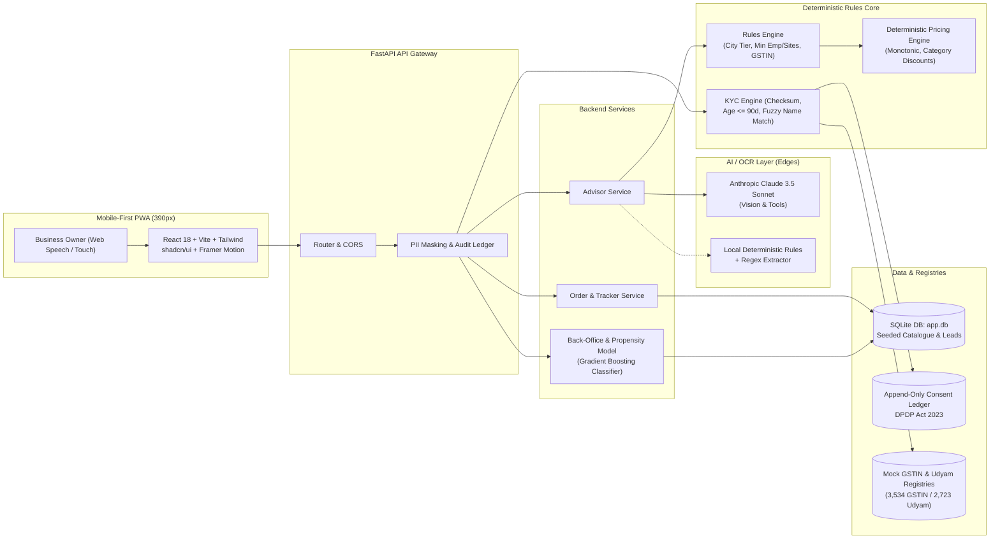

# Accel Business — Solution Architecture

## Overview
Project Udyam Digital employs a **Deterministic Core with LLM at the Edges** architecture. Business rules, product eligibility, dependency gating, and pricing arithmetic are handled strictly by a deterministic Python engine. AI is strictly leveraged for conversation slot-filling, plain-language explanations in 10 Indian languages, and document field extraction.

## Trust Boundary & Data Flows
- **LLM Trust Boundary:** Identity numbers (GSTIN, Udyam, PAN, phone numbers) are masked or redacted before reaching external LLM calls. The advisor conversation only transmits anonymized business profile attributes (industry, staff count, branch count, city tier).
- **Data Minimisation:** Raw identity documents are uploaded only when registry lookup requires supplementary proof, and raw images are earmarked for deletion within 30 days per DPDP guidelines.
- **Append-Only Consent Ledger:** Every customer consent is hashed and permanently recorded with purpose, timestamp, and language.
